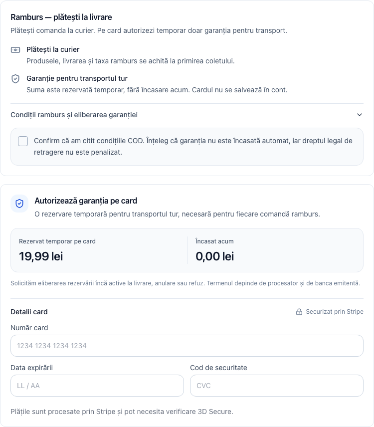

# COD checkout UI — 15 October 2026

The cash-on-delivery payment step previously repeated the full COD policy in narrow, equal-height cards and in the card-authorization panel. On desktop this produced several screens of text before the card form and continuation action.

The revised payment step uses compact fee/total rows, two short payment explanations, one expandable complete agreement, and a card panel that distinguishes the temporary shipping hold from the amount charged now. A single visible Continue action performs the consent check and starts authorization. It shows progress and disables navigation while authorization is running. Native card-form submission also checks consent. Online-card checkout retains its visible submit action.

The canonical consent text, version, shipping hold calculation, server-provided authorization amount, Stripe locale/country, and order payload are preserved. Policy links remain inside the agreement disclosure. New customer-facing copy is provided in Romanian and English.

Design reference: [Shopify checkout examples and guidance](https://www.shopify.com/enterprise/blog/checkout-pages), particularly short copy, transparent costs, and clear calls to action. Implementation follows the existing repository components and Tailwind styling.

## Verification

Six Jest suites / 26 tests pass:

```sh
pnpm exec jest --runInBand --selectProjects jsdom --runTestsByPath \
  __tests__/features/checkout/components/CodRambursConsentPanel.test.tsx \
  __tests__/features/checkout/components/CodRambursGuaranteePanel.test.tsx \
  __tests__/features/checkout/components/PaymentForm-mandatory-cod.test.tsx \
  __tests__/features/checkout/components/StripePaymentForm-submit.test.tsx \
  __tests__/features/checkout/components/PaymentMethodSelector.test.tsx \
  __tests__/features/checkout/components/CheckoutSummary-shipping.test.tsx
```

The existing guarantee and selector assertions were updated to match the existing Romanian price formatter (`25,00 lei`, `500,00 lei`). Selector tests now await their settings response.

Focused ESLint on the six edited implementation components exits successfully with zero errors and 43 warnings in existing code. Its TypeScript-aware parser requires a larger Node heap in this repository:

```sh
NODE_OPTIONS='--max-old-space-size=6144' pnpm exec eslint \
  features/checkout/components/PaymentForm.tsx \
  features/checkout/components/PaymentMethodSelector.tsx \
  features/checkout/components/PaymentSummary.tsx \
  features/checkout/components/StripePaymentForm.tsx \
  features/checkout/components/cod-panels/CodRambursConsentPanel.tsx \
  features/checkout/components/cod-panels/CodRambursGuaranteePanel.tsx
```

`pnpm typecheck` remains unsuccessful with 1,144 diagnostics across existing repository code, including translation duplicate keys, Prisma types, `LazyCheckoutStep`, and web-vitals. No diagnostics reference the edited implementation components or checkout tests. This is not a passing repository-wide typecheck.

Browser verification uses the actual PaymentForm, payment selector, payment summary, COD panels, StripePaymentForm, billing-address section, checkout stepper, order summary, and repository CSS, bundled into a temporary local fixture. Cart, session, settings/API responses, Next image/link adapters, and Stripe's SDK/Payment Element are synthetic. The fixture uses a 168 lei cart, a 19.99 lei shipping hold, and a synthetic payment-intent response. No real payments, database writes, or production deployment were performed.

Chromium checks passed at 1440, 1024, 768, 390, and 320 px:

- No horizontal overflow; agreement is collapsed initially and can be opened/closed.
- Complete canonical agreement and policy links remain available.
- One visible continuation action; no authorization without consent.
- Authorization progress and disabled continuation/back actions.
- Successful authorization hands the unchanged COD consent and guarantee payload to the review callback.
- Card error restores the continuation action without submitting the order.
- Keyboard Enter toggles the agreement, Space toggles consent, and native card-form submission succeeds after consent.
- No uncaught browser errors.

The same local fixture rendered the original components from Git HEAD for comparison. At 1440 px, full page height decreased from 4,007 px to 1,778 px (56%). This measures the fixture, including synthetic card fields, rather than a live production checkout. [Recorded browser measurements](./browser-results.json).

## Previews

These captures show synthetic card fields and cart content; they are layout evidence, not proof of a live Stripe authorization.

[Desktop checkout](./desktop.png) · [Mobile checkout](./mobile.png)


